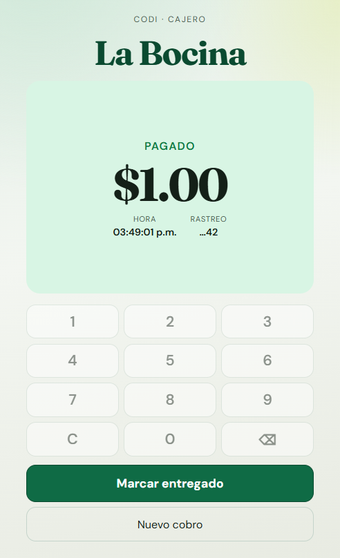
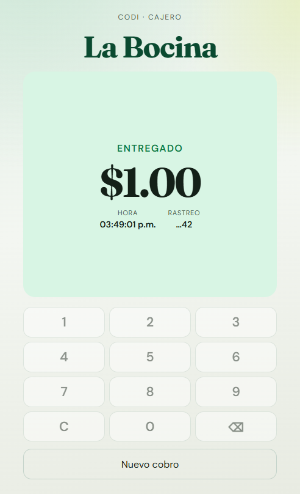
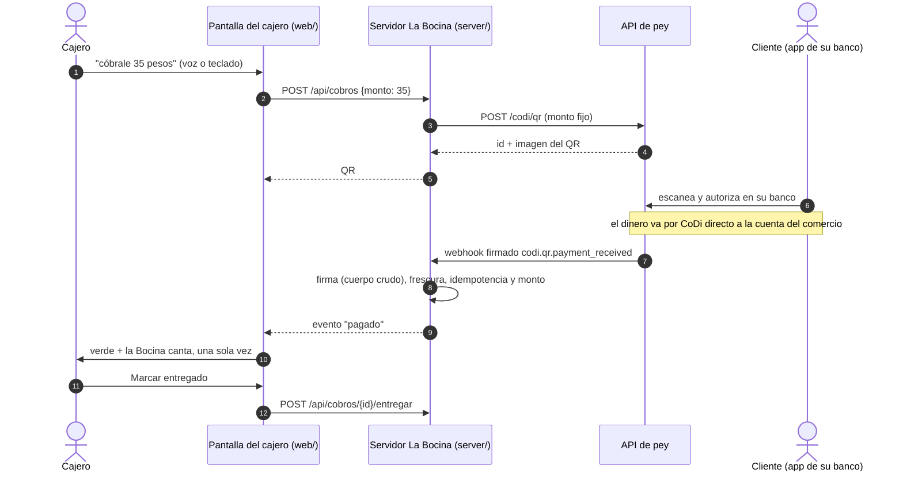

# La Bocina

**Cobro al entregar con CoDi, por voz y verificado por el banco.**

El repartidor o cajero dice «cóbrale 35 pesos». Aparece un QR CoDi con ese monto fijo,
el cliente paga desde la app de su banco y solo cuando el servidor verifica el aviso
firmado de pey, la pantalla se pone verde y el teléfono dice en voz alta cuánto llegó.
Hasta ese momento se libera «Entregado», una sola vez.

> **Una miente. La otra canta cuando el dinero ya llegó.**

> Cursor Hackatón México 2026 · Track #5 «Cobro al entregar»
> Equipo: Gabriel Zavarse, Rafael Cedillo y Oscar Garavito

<p align="center">
  
  &nbsp;&nbsp;
  
</p>
<p align="center"><sub>La pantalla real del cajero. Estas dos capturas salen de la prueba
automática local (<code>server/pruebas/</code>), que usa un pey simulado. El pago real está
en <a href="#9-pruebas-reales">Pruebas reales</a>.</sub></p>

Pitch y respuestas para jueces: [`PITCH.md`](PITCH.md).

---

## 1. El problema

- **La captura falsa.** Al entregar, al repartidor o al cajero le enseñan una captura de
  una «transferencia». No tiene la app del dueño para comprobarla, entrega a ciegas y,
  si la captura es falsa, la pérdida ya ocurrió.
- **La barrera de leer.** Las apps financieras piden leer menús, decimales y códigos de
  error. Muchos comerciantes son adultos mayores, tienen las manos ocupadas o no leen
  con facilidad.
- **Por qué ahora.** Las Circulares 9 y 10/2026 de Banxico obligan a los bancos a poner
  al frente las transferencias y la lectura de QR CoDi a más tardar el 14 de diciembre
  de 2026. El lado de quien paga queda resuelto por regulación; La Bocina resuelve el
  lado de quien cobra.

## 2. Cómo funciona

1. El cajero toca **Hablar** y dice «cóbrale 35 pesos», o teclea el monto. Un parser
   fijo en español de México, sin IA, saca el monto.
2. El servidor crea un QR CoDi con monto fijo (`POST /codi/qr`, `expiration: 360`,
   `generateImage: true`, `metadata.cobroId`).
3. El cliente escanea y autoriza en su banco (con su NIP, huella o cara).
4. pey manda el webhook `codi.qr.payment_received`. El servidor verifica la firma y los
   candados.
5. La pantalla se pone verde y la Bocina dice el monto **del aviso** y la terminación de
   la clave de rastreo.
6. Se habilita «Marcar entregado», que solo se puede registrar una vez.

Si el QR vence (6 minutos), desaparece de la pantalla con el aviso «Se venció. No
entregues», para que nadie lo capture ni lo imprima.



**La regla de oro:** la Bocina solo canta lo que llegó en un webhook con firma válida.
Nunca por un clic, por un temporizador ni por lo que el cajero dictó.

## 3. Pensado para operarse sin leer

| Situación | App tradicional | La Bocina |
|---|---|---|
| Comerciante que no lee o no trae lentes | Texto pequeño y menús | El monto en letra enorme, el estado en una palabra y la pantalla en verde, rojo o gris |
| Equivocarse con el punto decimal | Cobra $3.50 en vez de $35.00 | Se dicta por voz; el monto se ve enorme antes de pagar y el cliente lo vuelve a ver en su banco |
| Quien no distingue colores | Depende del color | Color + palabra («PAGADO») + voz |
| Saber si ya le pagaron | Leer un comprobante (falsificable) | Escucharlo, solo cuando llega el aviso firmado |

Lo que sigue en esta línea (todavía **no** está construido): botones de billetes por
color, confirmación hablada antes de cobrar («vas a cobrar treinta y cinco pesos»),
ícono grande, vibración y aviso por voz al vencer.

## 4. Cómo usamos pey

| Pieza de pey | Uso en La Bocina |
|---|---|
| `POST /codi/qr` | Un QR con monto fijo por cada cobro (`amount`, `concept`, `expiration: 360`, `numRef` de 1 a 7 dígitos, `generateImage`, `metadata.cobroId`; y `bankAccountId` en modo `cuenta_registrada`) |
| Webhook `codi.qr.payment_received` | Única fuente de verdad del pago, verificado con el esquema Standard Webhooks |
| `GET /transaction/codi/qr/{id}` | Respaldo cada 5 s mientras haya cobros pendientes, con la misma comprobación de monto |
| `GET /bank-account/{id}` | Revisión de arranque en modo `cuenta_registrada`: la cuenta destino debe estar `ACTIVE` (se ve en `/salud`) |

Todas las llamadas a pey salen del servidor; la API key nunca llega al navegador. El QR
se pinta con la imagen que devuelve pey, sin librería de QR. Detalle de campos en
[`docs/CONTRATO.md`](docs/CONTRATO.md) y [`docs/PEY_QUICKSTART.md`](docs/PEY_QUICKSTART.md).

## 5. Seguridad y antifraude

**Principio:** ninguna pantalla, captura, persona ni aviso basta por sí solo.

**Implementado:**

1. **Firma verificada.** Esquema Standard Webhooks sobre el cuerpo crudo, antes de
   parsear el JSON, con comparación en tiempo constante. Firma inválida → `401` y la
   Bocina no suena. Sin el secreto no se puede falsificar un aviso de pago.
2. **Anti-repetición.** Se rechazan avisos con `webhook-timestamp` a más de 5 minutos de
   la hora del servidor.
3. **Idempotencia.** Doble candado por `webhook-id` y `transactionId`: la Bocina habla
   una sola vez por pago. Persistido en SQLite, se mantiene tras reiniciar.
4. **Monto exacto.** El monto del QR y el del aviso deben coincidir; si no, el cobro pasa
   a error y la pantalla se pone roja. La Bocina dice el monto del aviso, no el dictado.
5. **Cobro vigente.** Un segundo pago a un QR ya pagado se marca «tardío, revisar» y no
   libera otra entrega. El QR vencido se retira de la pantalla.
6. **Entregado una sola vez.** Solo desde «pagado»; desde otro estado responde `409`.
7. **Secretos fuera del repo.** API key, secreto del webhook y llave de voz solo en
   `.env`, ignorado por git.
8. **Acceso y límites.** Las rutas que crean cobros o gastan voz y el MCP exigen token
   Bearer y tienen límite de peticiones por IP.
9. **Registro de pagos.** Cada pago queda registrado con `transactionId`, monto y hora,
   pensado para la trazabilidad que pide la Ley de Economía Digital.

**Hallazgos de las pruebas reales con pey (14 nov):**

- El aviso llega con `bankAccountId: null`, así que la cuenta no se puede validar con ese
  campo. El pago se liga al cobro por el `codiQrId` que pey devolvió al crear el QR. Por
  eso la demo corre en modo `credencial_propia`: la cuenta ligada a la API key es la del
  comercio.
- El formato de la clave de rastreo cambia según el banco del pagador (corto en unos,
  largo en otros), así que la Bocina dice la terminación sin asumir un formato.
- Las primeras pruebas nos sirvieron para depurar: `405` (ruta equivocada), `401`
  (firma) y luego `200` en el primer pago real verificado.

**No custodia.** La Bocina nunca toca el dinero: va del banco del cliente a la cuenta
registrada. En la demo usamos una cuenta de prueba preautorizada por pey; en producción,
la CLABE del comercio.

Revisado línea por línea, en varias rondas, por Égida, nuestro agente de seguridad con
IA (14 nov). Detalle, cómo comprobarlo y **límites conocidos** en
[`docs/SEGURIDAD.md`](docs/SEGURIDAD.md).

## 6. Reglas de pey que respetamos

- **Cuenta activa o no hay cobro.** El servidor opera en modo declarado
  (`cuenta_registrada` o `credencial_propia`). En `cuenta_registrada` se niega a cobrar
  si la cuenta no está `ACTIVE`.
- **Sin links de pago en ventas.** No reciben `bankAccountId` por transacción, así que no
  se usan para cobrar ventas. No aparecen en el código.
- **Un comercio por credencial.** Diseñado para respetar los términos de pey (Koshi S.A.
  de C.V.). El modelo con varios comercios requiere autorización escrita (cláusula 5.4),
  que está pendiente de confirmar con pey.
- No cobramos a nombre de terceros.

## 7. Para agentes de IA (MCP)

Herramienta `cobrar(monto, concepto)`, protegida por token, que llama exactamente la
misma función interna que el cajero. El agente solo puede crear cobros: no puede marcar
«pagado» ni «entregado». Los cobros del agente aparecen solos en la pantalla del cajero.
Cómo conectarlo: [`mcp/README.md`](mcp/README.md).

## 8. Cómo probarlo

**En vivo (juez):**

1. Abre `<URL EN VIVO>` en un Android con Chrome y sube el volumen.
2. Toca **Hablar** y di «cóbrale un peso» (o teclea `100` y toca **Cobrar**).
3. Escanea el QR desde tu app bancaria con CoDi y autoriza. Corre en producción: el pago
   es real y no se reembolsa.
4. La pantalla se pone verde y la Bocina dice el monto.

**Local** (Python 3.11+ y Node 20+):

```bash
# servidor
cd server
python -m venv .venv
source .venv/bin/activate            # Windows: .\.venv\Scripts\Activate.ps1
pip install -r requirements.txt
cp .env.example .env                 # llena los valores (docs/PEY_QUICKSTART.md)

# pantalla: se compila y el mismo servidor la sirve en GET /
cd ../web
cp .env.example .env                 # VITE_API_TOKEN = LA_BOCINA_API_TOKEN del servidor
npm install && npm run build

cd ../server
uvicorn main:app --host 127.0.0.1 --port 8000
```

No uses `--reload`: se cuelga con las conexiones de eventos abiertas. pey necesita
alcanzar `POST /webhooks/pey` por HTTPS, así que expón el puerto con un túnel o
despliégalo. Revisa `GET /salud`: dice el modo de comercio y el estado de la cuenta, sin
secretos.

Los nombres de las variables están en [`server/.env.example`](server/.env.example), sin
valores.

**Sin gastar un peso:** `server/pruebas/` trae un pey simulado y dos pruebas automáticas.
Una recorre el API (firma forjada, repetición, idempotencia, monto distinto, MCP, voz) y
la otra maneja la pantalla real en un navegador. Ver
[`server/pruebas/README.md`](server/pruebas/README.md).

## 9. Pruebas reales

El 14 de noviembre se hizo un pago real por CoDi y lo confirmó el webhook firmado de pey:
`POST /webhooks/pey 200 OK` y el cobro en estado `pagado`. Después se ensayó el recorrido
completo de punta a punta.

<!-- PENDIENTE DEL EQUIPO: llenar con los datos medidos y quitar este comentario.

| Banco | Pago → webhook (s) | ¿Dejó editar el monto? | ¿Pagar 2 veces el mismo QR? | ¿Pagar QR vencido? |
|---|---|---|---|---|
| BBVA | ___ | ___ | ___ | ___ |
| ___ | ___ | ___ | ___ | ___ |

Y agregar la captura recortada del log (sin CLABE completa ni apiKeyId):

-->

## 10. Qué construimos y qué no

**Construido el 14 de noviembre de 2026:**

- Servidor con verificación de firma, `POST /codi/qr`, consulta de respaldo, eventos
  hacia la pantalla, persistencia en SQLite, token y límite de peticiones, y `/salud`.
- Pantalla del cajero con voz (parser fijo, es-MX), teclado, QR, verde y la Bocina.
- «Marcar entregado», de una sola vez.
- Herramienta MCP `cobrar()`.
- Voz con motor intercambiable y cadena de respaldo.

**Límites de hoy, dichos por nosotros:**

- La transcripción de voz en servidor usa un modelo de paga. Sin crédito responde error
  y se cobra con el teclado, que siempre está visible.
- El servidor todavía no marca un cobro como vencido; lo impide pey al vencer el QR y la
  pantalla lo retira.
- El modo `cuenta_registrada` necesita que el aviso traiga `bankAccountId`, y en las
  pruebas llegó `null`. Hoy solo se usa `credencial_propia`.
- El token de la pantalla viaja en el JavaScript del navegador: frena el abuso casual,
  no es un secreto. Lo que protege el dinero es que el verde solo nace de un aviso
  firmado.
- Demo de un solo comercio.
- En `server/main.py` quedan tres puntos marcados `[CONFIRMAR]` contra la documentación
  de pey.

**No construido (siguiente paso):**

- Cobro push al teléfono del cliente (`/codi/pn`).
- Cobro por NFC: el cliente acerca su teléfono a una etiqueta y se abre el cobro.
- Cartón impreso de mostrador (QR sin monto ni expiración): solo para ventas de
  mostrador, nunca para liberar entregas, porque el cliente escribe el monto. Falta
  confirmar que pey lo permite.
- Botones de billetes por color y confirmación hablada antes de cobrar.
- Libreta de fiado, tablero del dueño y bitácora inmutable con hashes encadenados.
- Alertas de fraude, tokens por dispositivo y conciliación diaria con pey.

## 11. Estructura del repo

```
la-bocina/
├── server/            Servidor FastAPI: cobros, webhook, eventos, voz, mini-MCP
│   ├── main.py
│   ├── .env.example   Nombres de variables, sin valores
│   └── pruebas/       Prueba de punta a punta con un pey simulado
├── web/               Pantalla del cajero (Vite + TypeScript, sin framework)
├── mcp/               Cómo conectar un agente a cobrar()
├── docs/              Contrato, arranque con pey, seguridad y el sprint del día
├── PITCH.md
└── README.md
```

El API propio (los `POST` llevan `Authorization: Bearer <token>`; los `GET` no):

| Ruta | Para qué |
|---|---|
| `GET /` | Pantalla del cajero (si `web/dist` está compilado) |
| `POST /api/cobros` | `{monto, concepto, canal}` → `201 {id, estado, monto, qrImage}` |
| `GET /api/cobros/{id}` · `GET /api/cobros/{id}/qr` | Estado de un cobro · su QR como PNG |
| `GET /api/eventos` | Eventos del servidor: `creado`, `pagado`, `tardio`, `error`, `entregado` |
| `POST /api/cobros/{id}/entregar` | Marca entregado un cobro **pagado** |
| `POST /webhooks/pey` | Recibe y **verifica** los webhooks de pey |
| `POST /api/tts` · `POST /api/stt` | La Bocina canta · micrófono a texto |
| `POST /mcp` | Herramienta `cobrar(monto, concepto)` para agentes |
| `GET /salud` | Modo de comercio y estado de la cuenta, sin secretos |

## 12. Declaración

Todo el código se escribió durante el hackatón, a partir del 14 de noviembre de 2026,
con ayuda de agentes de IA para programar y para auditar. El paquete de la demo es
simulado; el pago es real. No hay llaves en el repositorio ni en su historial.

Librerías y servicios de terceros: [FastAPI](https://fastapi.tiangolo.com/),
[Uvicorn](https://www.uvicorn.org/), [HTTPX](https://www.python-httpx.org/),
[python-dotenv](https://github.com/theskumar/python-dotenv),
[edge-tts](https://github.com/rany2/edge-tts) y SQLite en el servidor;
[Vite](https://vite.dev/) y [TypeScript](https://www.typescriptlang.org/) en la pantalla,
con las tipografías Fraunces y DM Sans; el API de [pey](https://docs.pey.mx) para CoDi y
[OpenRouter](https://openrouter.ai/) para los modelos de voz.
